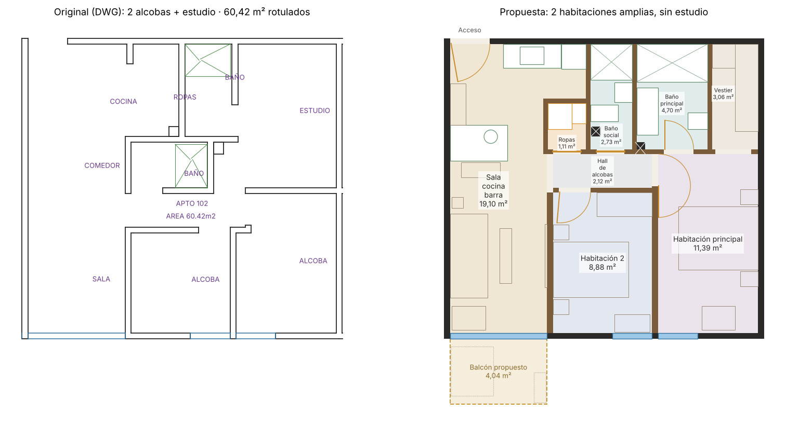
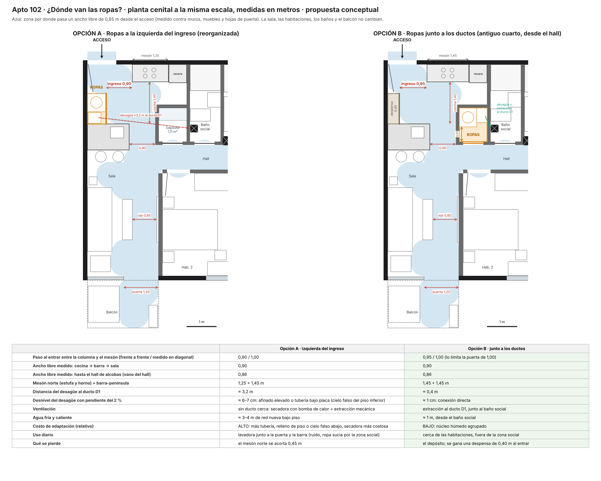

# Propuesta de redistribución – apto 102 · Torre 1 · Pinares Ártica Home

> **Rediseño conceptual / propuesta comercial. No es planta verificada ni aprobada del proyecto.**
> Parte del apartamento 102 del DWG (`PLANTA PISO 1 AL PISO 20 · TORRE 1`, rotulado 60,42 m²), pero la
> distribución interior es nueva.

**Versión vigente (barra y ropas junto a los ductos).** Sobre la primera propuesta se aprobaron estos
ajustes:
- el comedor tradicional se reemplaza por una barra-península de 2 puestos integrada a la cocina en U;
- la zona de ropas queda en el cuarto junto a los ductos, con entrada desde el hall y puerta corrediza
  oculta en el muro. Se evaluó una columna junto al acceso y se descartó (ver «Ropas: por qué junto a
  los ductos»);
- al ingresar queda una despensa de 0,40 m y un paso libre de 0,95 m.

La estética por defecto del visor es «Monocromática elegante»: blanco, grises y negro mate.

## Qué se conserva del DWG y qué cambia

| Se conserva (DWG) | Cambia (propuesta) |
| --- | --- |
| Envolvente de 8,074 × 7,60 m: medianeros, muro del corredor y fachada | Todos los tabiques interiores |
| Vanos de fachada: ventana de 2,449 m de la sala y dos ventanas de 1,00 m | Cocina, baños, zona de ropas, despensa y puertas interiores |
| Puerta de acceso P2 de 1,00 m, en la misma esquina | Se elimina el estudio |
| Los dos ductos verticales del núcleo húmedo | Balcón de 4,04 m² frente a la sala (propuesta, como en el 104) |

## Nueva distribución

| Espacio | Área neta | Qué tiene |
| --- | --- | --- |
| Sala · cocina · barra | 19,10 m² | Espacio abierto de 7,30 m de fondo. Sala de 3,90 m de fondo frente al balcón; cocina en U con mesón norte (estufa y horno), nevera de columna y barra-península de 1,45 × 0,90 m con lavaplatos y 2 banquetas; despensa de 0,40 m al ingresar. Sin comedor tradicional |
| Habitación principal | 11,39 m² | Cama de 1,60 m, mesas de noche, butaca junto a la ventana |
| Baño principal (privado) | 4,70 m² | Ducha de 1,78 m con mampara, doble lavamanos y sanitario suspendido. Se entra desde la habitación |
| Vestier | 3,06 m² | Clósets en L y espejo de cuerpo entero. Se entra desde la habitación |
| Habitación 2 | 8,88 m² | Cama doble, mesas de noche suspendidas, armario corredizo de 1,40 m y cómoda baja bajo la ventana (dormitorio completo, no estudio) |
| Baño social | 2,73 m² | Ducha, sanitario suspendido y lavamanos. Sirve a la habitación 2 y a la zona social |
| Ropas | 1,11 m² | Lavadora-secadora apilada, lavadero y almacenamiento, junto a los ductos. Puerta corrediza oculta en el muro, al ras y con su acabado, desde el hall |
| Hall de alcobas | 2,12 m² | Reparte las dos habitaciones, el baño social y la zona de ropas |
| **Interior neto** | **53,97 m²** | Muros dentro de la envolvente: 7,36 m². Envolvente bruta: 61,36 m² |
| Balcón propuesto | 4,04 m² | 2,449 × 1,65 m, exterior a la envolvente. Hoja corrediza que abre al este (paso libre de 1,20 m en el eje de la sala) |

Las áreas se calculan sobre una malla de 1 cm (`tools/disenar_102.py`). El rótulo comercial del plano
(60,42 m²) no se modifica: como en el 104, el DWG no dice cómo se midió.

## Circulaciones y medidas

Medidas libres tomadas en la planta y comprobadas en el modelo 3D del visor (rayos horizontales contra
muros, muebles y aparatos; prueba automática en `tests/apartamento-102.test.cjs`).

| Medida | Valor |
| --- | --- |
| Paso al entrar, entre la despensa y el mesón norte | 0,95 m frente a frente; 1,00 m medido (lo limita la puerta de acceso) |
| Paso entre la barra y el tabique de ropas | 0,90 m |
| Eje libre cocina – sala – balcón | 0,85 m, recto, entre la mesa de centro y el televisor |
| Entrada al hall de alcobas | 0,86 m medido |
| Paso libre de la puerta del balcón | 1,20 m (hoja corrediza recogida al oeste) |
| Cocina: entre la barra y el mesón norte | 1,45 m |
| Barra-península | 1,45 × 0,90 m, altura 0,90 m, voladizo de 0,30 m hacia la sala, 2 puestos |
| Mesón norte (estufa y horno) | 1,45 m, desde 1,50 m del medianero |
| Despensa al ingresar | 0,40 × 1,05 m, altura completa, integrada a la carpintería de la cocina |
| Frente libre ante la lavadora | 0,51 m dentro del cuarto, más el hall al abrir la puerta |

### Ropas: por qué junto a los ductos

Se compararon dos ubicaciones a la misma escala:

| | Columna a la izquierda del ingreso | Cuarto junto a los ductos (elegida) |
| --- | --- | --- |
| Paso al entrar | 0,90 m (con el mesón reducido a 1,25 m) | 0,95 m con mesón de 1,45 m |
| Desagüe al ducto D1 | ≈3,2 m: 6–7 cm de afinado elevado o tubería bajo placa | ≈0,4 m: conexión directa |
| Ventilación | sin ducto cerca: secadora de bomba de calor y extracción mecánica | extracción al ducto D1 |
| Agua | 3–4 m de red nueva bajo piso | ≈1 m desde el baño social |
| Costo de adaptación | alto | bajo |
| Uso diario | lavadora en la zona social, junto a la barra | cerca de las habitaciones |

Lo que hay que confirmar con el ingeniero hidrosanitario: conexión del desagüe y de la extracción al
ducto D1, circuito eléctrico dedicado e impermeabilización del piso del cuarto.

## Por qué es mejor

1. **Dos habitaciones de verdad en lugar de «2 + estudio».**
   - La alcoba pequeña del plano original (2,50 × 2,52 m, 6,30 m²) pasa a ser una habitación de
     8,88 m² con cama doble, armario y cómoda.
   - El estudio sin ventana desaparece. Su área se usa para la suite principal y para los servicios.
2. **Suite principal.**
   - La habitación principal tiene ahora baño privado (4,70 m²) y vestier (3,06 m²), con acceso solo
     desde la habitación.
   - En total son 19,15 m² de uso privado. Es el argumento comercial más fuerte de un apartamento de
     60 m².
3. **Circulación corta.**
   - Un solo hall de 2,12 m² reparte cuatro puertas: las dos habitaciones, el baño social y ropas.
   - No hay pasillos largos, y el área se va a los recintos.
4. **Zona social continua.**
   - Sala, cocina y barra forman un solo espacio de 19,10 m² con luz de la ventana de 2,45 m.
   - Sin comedor tradicional, la sala gana fondo (3,90 m) y queda un eje recto hasta el balcón.
   - El balcón propuesto actúa como extensión de la sala: el recorrido lo presenta como parte de la
     zona social.
5. **Cocina moderna y funcional.**
   - Cocina en U: mesón norte de 1,45 m con estufa y horno, nevera de columna y barra-península con
     lavaplatos, que sirve también para comer.
   - Abierta a la sala, pero fuera del paso entre el hall y la sala.
6. **Ropas resuelta sin estorbar.**
   - Cuarto propio junto a los ductos, con puerta corrediza oculta al ras del muro.
   - No invade la cocina ni el ingreso, que queda libre con una despensa.
7. **Núcleo húmedo agrupado.**
   - Los dos baños y ropas quedan juntos, alrededor de los dos ductos del DWG.
   - Así se simplifican las redes hidrosanitarias y de ventilación.
   - Así se simplifican las redes hidrosanitarias y de ventilación.
8. **Luz natural donde se necesita.**
   - Cada habitación conserva su ventana de fachada.
   - Los recintos sin ventana son el hall, los baños, ropas y el vestier: servicios que se ventilan
     por ducto.

## Lo que hay que validar antes de ofrecerla

El registro completo y actualizado está en [PENDIENTES.md](PENDIENTES.md).

1. **Sistema estructural.**
   - Si los muros interiores de la torre son estructurales (por ejemplo, muros de concreto de sistema
     industrializado), no se pueden mover. Toda la propuesta depende de esto.
   - Lo debe confirmar el ingeniero estructural del proyecto.
2. **Redes hidrosanitarias y de gas:**
   - nuevas posiciones de baños, cocina, lavaplatos en la península y zona de ropas;
   - pendientes de desagüe;
   - ventilación de baños y ropas por los ductos existentes;
   - salida de la campana.
3. **Norma urbanística y licencia.**
   - La redistribución y, sobre todo, el balcón requieren revisar la licencia de construcción y su
     modificación.
4. **Coherencia entre unidades.**
   - El 102 comparte medianero con el 101 y el 103, y su distribución se repite en los pisos
     superiores.
   - Las bajantes deben coincidir piso a piso.
5. **Aprobación del arquitecto del proyecto.**

## En el visor

- **Rótulo permanente:** «Propuesta de redistribución – apto 102 · rediseño conceptual, no planta
  verificada».
- **Planta original del DWG:** una capa dibuja en rojo, sobre el piso, los muros originales, para
  comparar en la maqueta.
- **Solo envolvente del DWG:** oculta tabiques, aparatos, muebles, acabados y balcón de la propuesta,
  y deja la envolvente y la planta original.
- **Leyenda de cuatro categorías:**
  - envolvente, vanos y ductos del DWG;
  - medidas provisionales (alturas);
  - mobiliario y acabados ilustrativos;
  - redistribución y balcón propuestos.
- **Estética por defecto «Monocromática elegante»:** microcemento gris perla, muros blancos, cocina en
  negro mate con mármol gris, baños en piedra gris y negro mate. Las otras tres propuestas de acabados
  siguen disponibles.
- **Presentación visual (ver `INFORME-PRESENTACION.md`):**
  - estética «Monocromática cálida» por defecto: blanco cálido, greige, travertino claro, roble claro y negro
    mate como acento;
  - cocina de roble y travertino con península en cascada, banquetas de bouclé, colgantes opalinos, horno,
    nevera y lavavajillas integrados, grifería de latón cepillado y luz bajo repisas;
  - baños en travertino a toda altura, duchas a nivel con mampara de perfil negro, nichos iluminados,
    muebles suspendidos y espejos con luz indirecta;
  - habitaciones con cama de plataforma en roble, cabecero tapizado, mesas de noche suspendidas con luz y
    armarios hasta el cielo;
  - exterior conceptual con HDRI fotográfico y árboles 3D; escenas de día y atardecer;
  - materiales PBR propios con color, relieve y rugosidad (créditos en `CREDITOS.md`).
- **Lo mismo que en el 104:** maqueta, recorrido de 12 capítulos, caminata con colisiones, puntos de
  información, acabados en vivo y entorno exterior conceptual.

Supuestos de visualización (no del DWG): altura libre 2,40 m, puertas de 2,10 m, antepecho de 0,90 m
y tabiques de 0,12 m.
